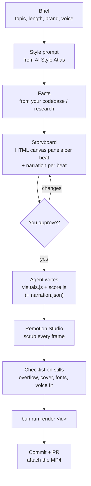

# code-motion

[English](README.md) | [ไทย](README.th.md)

[](LICENSE)

An agent skill for making product videos and animated explainers as code: canvas visuals and Web Audio sound, rendered to
MP4 with [Remotion](https://www.remotion.dev), in styles picked from
[Futurepedia AI Style Atlas](https://www.futurepedia.io/resources/ai-style-atlas/view).

No video editor: every frame is a pure function of time, all sound is synthesized or synced, and the video
lives in git as code, so you can review it in a PR and re-render it at any time.

Works with any coding agent that can read files and run shell commands: Claude Code, Codex,
Cursor, OpenCode, and others. The skill is plain Markdown plus Bun commands.

---

## Repository & Folder Organization

```text
code-motion-skill/
├── skills/
│   └── code-motion/
│       ├── SKILL.md                 # Agent skill instructions & workflow gates
│       └── REFERENCE.md             # Technical reference (Remotion shell, Web Audio, voiceover APIs)
├── prompts/
│   ├── voxel-diorama.md             # Voxel Diorama (Dimensional) reference prompt & audio kit
│   ├── voiceover-video-prompts.md   # Copy-paste prompts for narrated videos
│   ├── suno-music-video-prompt.md   # AI music video prompt templates
│   └── claude-desktop-prompt.md     # Instructions for Claude Desktop & chat prompts
├── docs/
│   ├── music-video-guide.md         # Guide for code-motion music videos
│   └── music-video-guide.th.md      # Thai edition
└── examples/tutorial/               # Full Remotion video project
    ├── package.json
    ├── scripts/
    │   ├── render.ts                # bun run render <id> (--audio for WAV only)
    │   ├── stills.ts                # bun run stills <id> <t1> <t2>...
    │   └── voiceover.ts             # bun run voiceover <id> (Edge TTS / ElevenLabs)
    ├── src/
    │   ├── lib/                     # Core math, noise & Web Audio kit (harness.js, sound.js)
    │   ├── style/                   # Style engines (voxel.js, manga.js, blueprint.js)
    │   ├── videos/                  # Canonical repo examples (tutorial, launch)
    │   ├── Root.tsx
    │   ├── VideoCanvas.tsx
    │   └── config.ts
    └── public/                      # Self-hosted OFL fonts, fonts.css & logos
```


### Git Policy: Core Code vs. Generated Assets

To keep the repository clean, reproducible, and lightweight:
- **Included in Git (The Core):**
  - All skill definitions (`skills/code-motion/`)
  - Prompts, style guides, and documentation (`prompts/`, `docs/`)
  - Visual and audio source code (`src/videos/`, `src/lib/`, `src/style/`)
  - Automation scripts (`scripts/render.ts`, `scripts/voiceover.ts`, `scripts/stills.ts`)
  - Standalone HTML players, storyboards, and web font definitions.
- **Excluded from Git (Generated Assets via `.gitignore`):**
  - Rendered MP4 videos (`out/*.mp4`, `out/`)
  - Rendered test stills (`out/*.png`)
  - Rendered synthesized audio (`public/*.wav`, `*.wav`)
  - Synthesized voiceover and music audio (`public/*.mp3`, `*.mp3`)
  - Environment files with API keys (`.env`, `*.env`)
  - Remotion build caches (`.remotion/`)

---

## How It Works

### Workflow



### Render Pipeline

```mermaid
flowchart LR
  subgraph code["In git (Core)"]
    visuals["visuals.js<br/>draw(ctx, W, H, t)"]
    score["score.js<br/>sound synthesis events"]
    style["voxel.js / manga.js<br/>projection & shading"]
    narration["narration.json<br/>voiceover text per beat"]
  end
  subgraph browser["Headless Chrome / Web Audio"]
    canvas["Canvas<br/>frame at t = frame / fps"]
    webaudio["Web Audio<br/>offline render"]
  end
  visuals --> canvas
  style --> canvas
  score --> webaudio
  webaudio --> wav[("public/&lt;id&gt;.wav (Generated)")]
  narration --> tts["ElevenLabs or Edge TTS<br/>exact beat timing"]
  tts --> voice[("public/&lt;id&gt;-voice.mp3 (Generated)")]
  canvas --> remotion["Remotion Bundler"]
  wav --> remotion
  voice --> remotion
  remotion --> mp4[("out/&lt;id&gt;.mp4 (Generated)")]
```

Same code in, same video out: re-render any time with `bun run render <id>`.

---

## Canonical Example: Code Motion Tutorial Video

A 34-second tutorial video about the `code-motion` skill, built by following the skill end-to-end in the Manga Page visual style. It illustrates the complete anatomy of a real project: `visuals.js`, `score.js`, vertical 9:16 cut, self-hosted OFL fonts, render scripts, and optional voiceover.

- **ID:** `tutorial` (16:9 Landscape) · `tutorial-vertical` (9:16 Portrait)
- **Resolution:** 1280×720 or 1080×1920, 60 fps
- **Duration:** 34.0 seconds
- **Synthesized Sound:** Web Audio percussive hits, panel sweeps, and chime cues.
- **Voiceover:** Optional Thai or English voiceover via `narration.json`.

### Commands to Run:

```bash
cd examples/tutorial

# 1. Preview in Remotion Studio
bun run studio                  # Opens at http://localhost:3000

# 2. Render Synthesized Audio
bun run render tutorial --audio

# 3. Render Final MP4 Video
bun run render tutorial         # Output: out/tutorial.mp4
bun run render tutorial-vertical # Output: out/tutorial-vertical.mp4

# 4. Extract Test Stills
bun run stills tutorial 0 5 12 20 28 34
```


---

## Install the Skill

**With the [skills CLI](https://github.com/vercel-labs/skills)** (Node.js 22.20+), from your project:

```bash
npx skills add savepong/code-motion-skill
```

Add `-g` to install it globally for all your projects.

**Claude Code:**

```bash
git clone --depth 1 https://github.com/savepong/code-motion-skill /tmp/code-motion-skill
mkdir -p .claude/skills
cp -R /tmp/code-motion-skill/skills/code-motion .claude/skills/
```

Then invoke with `/code-motion`.

**Codex, Cursor, OpenCode and others:** Copy the skill to `.agents/skills/code-motion/` and add to your `AGENTS.md`:

```md
To make or re-render a product video or animated explainer, read and follow `.agents/skills/code-motion/SKILL.md`.
```

---

## Requirements

- **Runtime:** [Bun](https://bun.sh/)
- **Video Renderer:** Remotion 4.0.530 (downloads headless Chrome on first run)
- **Media Tools:** `ffmpeg` and `ffprobe` on your system `PATH`
- **Voiceover:**
  - Free Edge TTS: Works out-of-the-box (no API key required).
  - ElevenLabs: Requires `ELEVENLABS_API_KEY` in `.env` or system environment.

---

## Contributing

Pull requests and issues are welcome: bug fixes, new style projection engines, or improvements to `SKILL.md`. Ensure that generated media files (`.mp4`, `.wav`, `.mp3`) and `.env` files are never included in PRs.

## License

MIT for the code and docs in this repo. See [LICENSE](LICENSE).
