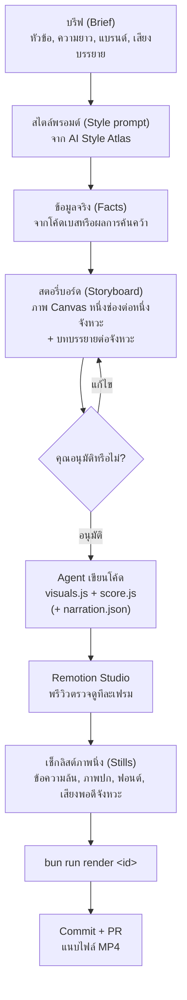

# code-motion

[English](README.md) | [ไทย](README.th.md)

[](LICENSE)

สกิลสำหรับ AI coding agent เพื่อสร้างวิดีโอแนะนำผลิตภัณฑ์และวิดีโออธิบายแนวคิดด้วยโค้ด (Video as code): วาดภาพด้วย Canvas และสังเคราะห์เสียงด้วย Web Audio เรนเดอร์ออกมาเป็นไฟล์ MP4 ด้วย [Remotion](https://www.remotion.dev) ตามสไตล์ที่เลือกจาก [Futurepedia AI Style Atlas](https://www.futurepedia.io/resources/ai-style-atlas/view)

ไม่ต้องใช้โปรแกรมตัดต่อวิดีโอ: ทุกเฟรมคือ Pure function ของเวลา (Time) เสียงทั้งหมดถูกสังเคราะห์ขึ้นมา และตัววิดีโอถูกเก็บไว้ใน Git ในรูปแบบโค้ด ทำให้คุณสามารถตรวจสอบผ่าน Pull Request (PR) และสั่งเรนเดอร์ใหม่ได้ตลอดเวลา

ใช้งานได้กับ Coding Agent ทุกตัวที่สามารถอ่านไฟล์และรันคำสั่ง Shell ได้ ไม่ว่าจะเป็น Claude Code, Codex, Cursor, OpenCode, Antigravity และอื่นๆ ตัวสกิลเป็นไฟล์ Markdown ธรรมดาพร้อมคำสั่งสำหรับ Bun

---

## โครงสร้างและการจัดระเบียบโฟลเดอร์ (Repository Organization)

```text
code-motion-skill/
├── skills/
│   └── code-motion/
│       ├── SKILL.md                 # คำสั่งหลักของสกิลและเกณฑ์การทำงาน
│       └── REFERENCE.md             # เอกสารอ้างอิงทางเทคนิค (Remotion shell, Web Audio, ระบบเสียงบรรยาย)
├── prompts/
│   ├── voxel-diorama.md             # สไตล์พรอมต์ Voxel Diorama (Dimensional) และชุดคำสั่งเสียง
│   ├── voiceover-video-prompts.md   # ตัวอย่างพรอมต์สั่งทำวิดีโอพร้อมเสียงบรรยาย
│   ├── suno-music-video-prompt.md   # พรอมต์สร้างมิวสิควิดีโอเพลง AI Suno
│   └── claude-desktop-prompt.md     # คำสั่งสำหรับ Claude Desktop และแชต AI
├── docs/
│   ├── music-video-guide.md         # คู่มือการสร้างมิวสิควิดีโอด้วย code-motion
│   └── music-video-guide.th.md      # ฉบับภาษาไทย
└── examples/tutorial/               # โปรเจกต์ตัวอย่างมาตรฐาน (Canonical Examples)
    ├── package.json
    ├── scripts/
    │   ├── render.ts                # สั่งเรนเดอร์ MP4 และ WAV
    │   ├── stills.ts                # สกัดภาพนิ่ง PNG ตามช่วงเวลา
    │   └── voiceover.ts             # สังเคราะห์เสียงบรรยาย (Edge TTS / ElevenLabs)
    ├── src/
    │   ├── lib/                     # ฟังก์ชันคณิตศาสตร์ นอยส์ และ Web Audio (harness.js, sound.js)
    │   ├── style/                   # เอนจินสไตล์เรนเดอร์ (voxel.js, manga.js, blueprint.js)
    │   ├── videos/                  # ตัวอย่างทางการ (tutorial, launch)
    │   ├── Root.tsx
    │   ├── VideoCanvas.tsx
    │   └── config.ts
    └── public/                      # ฟอนต์ OFL และไฟล์ไอคอน
```


### นโยบาย Git: โค้ดหลัก vs ไฟล์ที่สร้างขึ้น (Generated Assets)

เพื่อให้โค้ดเบสสะอาด น้ำหนักเบา และสามารถนำไปใช้งานต่อได้ง่าย:
- **สิ่งที่ถูกบันทึกลง Git (The Core):**
  - ไฟล์คำสั่งสกิลทั้งหมด (`skills/code-motion/`)
  - พรอมต์ สไตล์ไกด์ และเอกสารประกอบ (`prompts/`, `docs/`)
  - โค้ดสำหรับวาดภาพและสังเคราะห์เสียง (`src/lib/`, `src/style/`, `src/videos/`)
  - สคริปต์อัตโนมัติ (`scripts/render.ts`, `scripts/voiceover.ts`, `scripts/stills.ts`)
  - ไฟล์เว็บเพจสตอรี่บอร์ด เครื่องเล่นแบบสแตนด์อโลน และฟอนต์ที่โฮสต์เอง
- **สิ่งที่ไม่ถูกบันทึกลง Git (กำหนดไว้ใน `.gitignore`):**
  - ไฟล์วิดีโอผลลัพธ์ (`out/*.mp4`, โฟลเดอร์ `out/`)
  - ภาพนิ่งทดสอบ (`out/*.png`)
  - ไฟล์เสียงที่สังเคราะห์เสร็จแล้ว (`public/*.wav`, `*.wav`)
  - ไฟล์เสียงพากย์และไฟล์เพลง (`public/*.mp3`, `*.mp3`)
  - ไฟล์ข้อมูลลับหรือคีย์ API (`.env`, `*.env`)
  - แคชการคอมไพล์ของ Remotion (`.remotion/`)

---

## ขั้นตอนการทำงาน (Workflow)



---

## ตัวอย่างมาตรฐาน: วิดีโอสอนการใช้งาน Code Motion (Tutorial Video)

วิดีโอสอนการใช้งานความยาว 34 วินาทีเกี่ยวกับสกิล `code-motion` สร้างขึ้นด้วยขั้นตอนของสกิลอย่างสมบูรณ์ในสไตล์ภาพ Manga Page แสดงให้เห็นโครงสร้างที่แท้จริงของโปรเจกต์: `visuals.js`, `score.js`, เวอร์ชันแนวตั้ง 9:16, ฟอนต์ OFL ที่โฮสต์เอง, สคริปต์เรนเดอร์ และระบบเสียงบรรยาย

- **รหัส Composition:** `tutorial` (แนวนอน 16:9) · `tutorial-vertical` (แนวตั้ง 9:16)
- **ขนาดภาพ:** 1280×720 หรือ 1080×1920, 60 fps
- **ความยาว:** 34.0 วินาที
- **เสียงสังเคราะห์:** เสียงเอฟเฟกต์เพอร์คัชชันจาก Web Audio, การเปิดหน้าการ์ตูน และคอร์ดเสียง
- **เสียงบรรยาย:** รองรับเสียงบรรยายภาษาไทยหรืออังกฤษผ่าน `narration.json`

### คำสั่งสำหรับสั่งงาน:

```bash
cd examples/tutorial

# 1. เปิดพรีวิวใน Remotion Studio
bun run studio                  # เปิดที่ http://localhost:3000

# 2. เรนเดอร์เสียงสังเคราะห์
bun run render tutorial --audio

# 3. สั่งเรนเดอร์ไฟล์ MP4 ตัวเต็ม
bun run render tutorial         # ผลลัพธ์: out/tutorial.mp4
bun run render tutorial-vertical # ผลลัพธ์: out/tutorial-vertical.mp4

# 4. สกัดภาพนิ่งสำหรับตรวจสอบ
bun run stills tutorial 0 5 12 20 28 34
```


---

## การติดตั้งสกิล

**ติดตั้งผ่าน [skills CLI](https://github.com/vercel-labs/skills)** (Node.js 22.20+):

```bash
npx skills add savepong/code-motion-skill
```

เพิ่ม `-g` เพื่อติดตั้งให้ใช้งานได้กับทุกโปรเจกต์ในเครื่อง

**Claude Code:**

```bash
git clone --depth 1 https://github.com/savepong/code-motion-skill /tmp/code-motion-skill
mkdir -p .claude/skills
cp -R /tmp/code-motion-skill/skills/code-motion .claude/skills/
```

จากนั้นเรียกใช้ผ่านคำสั่ง `/code-motion`

**Codex, Cursor, OpenCode และอื่นๆ:** คัดลอกโฟลเดอร์สกิลไปไว้ที่ `.agents/skills/code-motion/` แล้วเพิ่มบรรทัดนี้ใน `AGENTS.md`:

```md
To make or re-render a product video or animated explainer, read and follow `.agents/skills/code-motion/SKILL.md`.
```

---

## ความต้องการของระบบ (Requirements)

- **รันไทม์:** [Bun](https://bun.sh/)
- **ตัวเรนเดอร์วิดีโอ:** Remotion 4.0.530 (จะดาวน์โหลด Headless Chrome อัตโนมัติในการรันครั้งแรก)
- **เครื่องมือจัดการมัลติมีเดีย:** มี `ffmpeg` และ `ffprobe` ในตัวแปร PATH ของระบบ
- **การสร้างเสียงบรรยาย:**
  - Edge TTS (ฟรี): ใช้งานได้ทันทีโดยไม่ต้องใช้ API Key
  - ElevenLabs: ต้องระบุ `ELEVENLABS_API_KEY` ในไฟล์ `.env` หรือตัวแปรสภาพแวดล้อม

---

## สัญญาอนุญาต (License)

MIT สำหรับโค้ดและเอกสารใน Repository นี้ ดูรายละเอียดได้ที่ [LICENSE](LICENSE)
