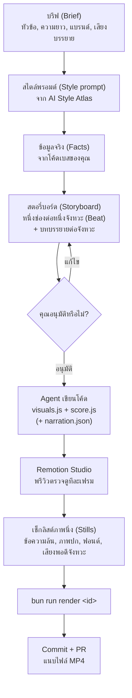
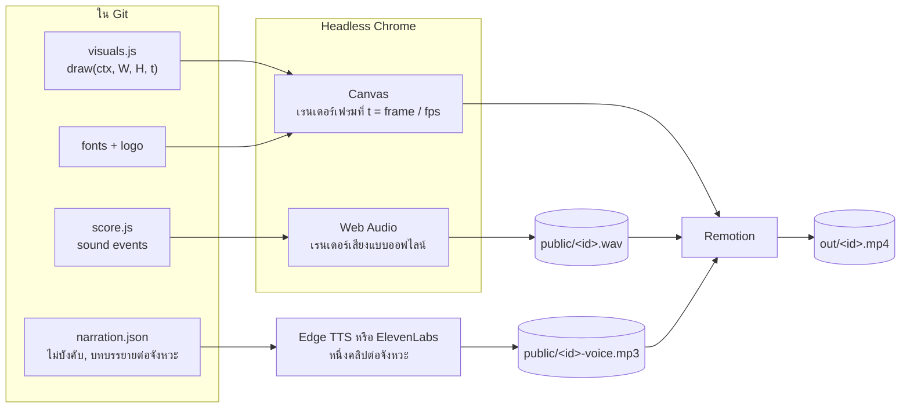

# code-motion

[English](README.md) | [ไทย](README.th.md)

[](LICENSE)

สกิลสำหรับ AI coding agent เพื่อสร้างวิดีโอแนะนำผลิตภัณฑ์ด้วยโค้ด (Product video as code): วาดภาพด้วย Canvas และสังเคราะห์เสียงด้วย Web Audio เรนเดอร์ออกมาเป็นไฟล์ MP4 ด้วย [Remotion](https://www.remotion.dev) ตามสไตล์ที่เลือกจาก [Futurepedia AI Style Atlas](https://www.futurepedia.io/resources/ai-style-atlas/view)

ไม่ต้องใช้โปรแกรมตัดต่อวิดีโอ: ทุกเฟรมคือ Pure function ของเวลา (Time) เสียงทั้งหมดถูกสังเคราะห์ขึ้นมา และตัววิดีโอถูกเก็บไว้ใน Git ทำให้คุณสามารถตรวจสอบผ่าน Pull Request (PR) และสั่งเรนเดอร์ใหม่ได้ตลอดเวลา

ใช้งานได้กับ Coding Agent ทุกตัวที่สามารถอ่านไฟล์และรันคำสั่ง Shell ได้ ไม่ว่าจะเป็น Claude Code, Codex, Cursor, OpenCode และอื่นๆ ตัวสกิลเป็นไฟล์ Markdown ธรรมดาพร้อมคำสั่งสำหรับ Bun

## หลักการทำงาน

### ขั้นตอนการทำงาน (Workflow)



### ไปป์ไลน์การเรนเดอร์ (Render pipeline)



โค้ดเดิมเข้ามา ได้วิดีโอผลลัพธ์เหมือนเดิมเสมอ: หากไฟล์ MP4 หาย เพียงรัน `bun run render <id>` ใหม่อีกครั้ง

### เสียงบรรยาย (ไม่บังคับ)

บทบรรยายเขียนแยกตามจังหวะใน `narration.json` ทำให้แต่ละประโยคเริ่มพร้อมกับฉากของมันและไม่เลื่อนเวลา คำสั่ง `bun run voiceover <id>` ใช้เสียง Neural จาก Edge TTS ฟรี หรือ ElevenLabs เมื่อตั้งค่า `ELEVENLABS_API_KEY` และจะไม่ยอมทำงานต่อหากมีประโยคใดยาวเกินเข้าไปในฉากถัดไป นอกจากนี้แต่ละวิดีโอยังกำหนดเฟรมเรตเองได้ (ค่าเริ่มต้น 30 หรือ 60 เพื่อการเคลื่อนไหวที่ลื่นกว่า) ตัวอย่างพรอมต์สำเร็จรูปอยู่ที่ [prompts/voiceover-video-prompts.md](prompts/voiceover-video-prompts.md)

## การติดตั้ง

**ติดตั้งผ่าน [skills CLI](https://github.com/vercel-labs/skills)** (Node.js 22.20+) จากโฟลเดอร์โปรเจกต์ของคุณ:

```bash
npx skills add savepong/code-motion-skill
```

ระบบจะถามว่าต้องการติดตั้งให้กับ Coding Agent ตัวใด (เช่น Claude Code, Codex, Cursor และอื่นๆ) เพิ่มออปชัน `-g` หากต้องการติดตั้งให้ใช้ได้กับทุกโปรเจกต์

**ติดตั้งด้วยตนเอง (Manual):** คัดลอกโฟลเดอร์สกิลเข้าไปในโปรเจกต์ของคุณ โดยใช้เพียงแค่ `skills/code-motion/`

**Claude Code**

```bash
git clone --depth 1 https://github.com/savepong/code-motion-skill /tmp/code-motion-skill
mkdir -p .claude/skills
cp -R /tmp/code-motion-skill/skills/code-motion .claude/skills/
```

จากนั้นใช้คำสั่ง `/code-motion` หรือพิมพ์สั่งให้สร้างวิดีโอได้ทันที หากต้องการให้มีในทุกโปรเจกต์ สามารถคัดลอกไปยัง `~/.claude/skills/` แทนได้

**Codex, Cursor, OpenCode และอื่นๆ:** คัดลอกไปยัง `.agents/skills/code-motion/` แล้วเพิ่มบรรทัดนี้ลงใน `AGENTS.md` ของคุณ:

```md
To make or re-render a product video, read and follow `.agents/skills/code-motion/SKILL.md`.
```

## วิธีใช้งาน

```text
/code-motion 25-second intro trailer for our app, in Thai, using our real logo
```

ติดตั้งสกิลในโปรเจกต์ของคุณ จากนั้นทำตามขั้นตอนที่ Agent สอบถาม กระบวนการทั้งหมดมีเพียงเท่านี้:

1. เลือกสไตล์จาก Style Atlas แล้วบันทึกพรอมต์ลงใน `prompts/<style>.md` เมื่อ Agent ร้องขอ
2. ตรวจสอบและอนุมัติสตอรี่บอร์ด (รวมถึงบทบรรยาย หากต้องการเสียงบรรยาย)
3. เปิดดูใน Remotion Studio (`bun run studio`, http://localhost:3000) และแจ้งสิ่งที่ต้องการปรับแก้
4. Agent จะสั่งรัน `bun run render <id>` โดยจะได้ไฟล์ MP4 อยู่ที่ `out/<id>.mp4`

## โครงสร้างภายใน Repository นี้

| เส้นทาง (Path)             | รายละเอียด (What)                                                         |
| -------------------------- | ------------------------------------------------------------------------- |
| `skills/code-motion/`      | ตัวสกิล: `SKILL.md` (ขั้นตอนการทำงาน, รายการตรวจสอบ) และ `REFERENCE.md` (โครงสร้าง Remotion shell, สคริปต์เสียงบรรยาย) |
| `examples/tutorial/`       | วิดีโอสอนการใช้งานความยาว 34 วินาที (ภาษาไทย) ที่สร้างขึ้นด้วยสกิลนี้      |
| `prompts/claude-desktop-prompt.md` | คำสั่งสำหรับใช้เวิร์กโฟลว์เดียวกันใน Claude Desktop / Claude Projects |
| `prompts/voiceover-video-prompts.md` | ตัวอย่างพรอมต์ทำวิดีโอพร้อมเสียงบรรยาย (สตอรี่บอร์ด, สไตล์เสียง, ความยาว, รูปแบบ, FPS) และโมเดลที่เหมาะสม |

### ตัวอย่าง: วิดีโอสอนการใช้งาน (Tutorial video)

วิดีโอสอนการใช้งานในสไตล์ Manga Page ทั้งขนาด 16:9 และ 9:16 ที่สร้างขึ้นจากการปฏิบัติตามสกิลนี้ตั้งแต่ต้นจนจบ แสดงให้เห็นโครงสร้างทั้งหมดของโปรเจกต์จริง: `visuals.js`, `score.js`, เวอร์ชันแนวตั้ง, การฝังฟอนต์ในตัว (Self-hosted fonts), สคริปต์สำหรับการเรนเดอร์ และสคริปต์เสียงบรรยาย ดูรายละเอียดการเรนเดอร์ได้ที่ [examples/tutorial/README.th.md](examples/tutorial/README.th.md) (หรือ [English](examples/tutorial/README.md))

## ความต้องการของระบบ (Requirements)

Bun และการเชื่อมต่ออินเทอร์เน็ตสำหรับการเรนเดอร์ครั้งแรก (เนื่องจาก Remotion จะดาวน์โหลด Headless Chrome) ทดสอบแล้วกับ Remotion 4.0.530 และ React 19.2.7

สำหรับเสียงบรรยาย: ต้องมี `ffmpeg` และ `ffprobe` ใน PATH และต้องเชื่อมต่ออินเทอร์เน็ตขณะสร้างเสียง ElevenLabs ต้องใช้ `ELEVENLABS_API_KEY` ส่วน Edge TTS ไม่ต้องใช้คีย์

## การมีส่วนร่วม (Contributing)

ยินดีต้อนรับทั้ง Issues และ Pull Requests: ไม่ว่าจะเป็นบั๊กที่พบระหว่างสร้างวิดีโอ, การปรับปรุง Shell, ตัวอย่างวิดีโอใหม่ๆ หรือคำแนะนำเพิ่มเติมใน `SKILL.md` หากคุณเพิ่มตัวอย่างใหม่ โปรดตัดสไตล์พรอมต์และโค้ดที่ได้จากพรอมต์ออก (ดูรายละเอียดด้านล่าง) และอธิบายวิธีดาวน์โหลดแทน

## เนื้อหาและลิขสิทธิ์ของบุคคลที่สาม (Third-party material)

สไตล์ต่างๆ มาจาก [Futurepedia AI Style Atlas](https://www.futurepedia.io/resources/ai-style-atlas/view) โดยพรอมต์, โค้ดอ้างอิง, ไลบรารีผู้ช่วย `H` และชุดเครื่องมือเสียง `SOUND` เป็นกรรมสิทธิ์ของ Futurepedia และไม่ได้รวมอยู่ใน Repository นี้ สำหรับฟอนต์ที่ใช้ในตัวอย่างอยู่ภายใต้สัญญาอนุญาต SIL Open Font License โดยไฟล์สัญญาอนุญาตจะวางอยู่ข้างๆ ไฟล์ฟอนต์

## สัญญาอนุญาต (License)

MIT สำหรับโค้ดและเอกสารใน Repository นี้ ดูรายละเอียดได้ที่ [LICENSE](LICENSE)
